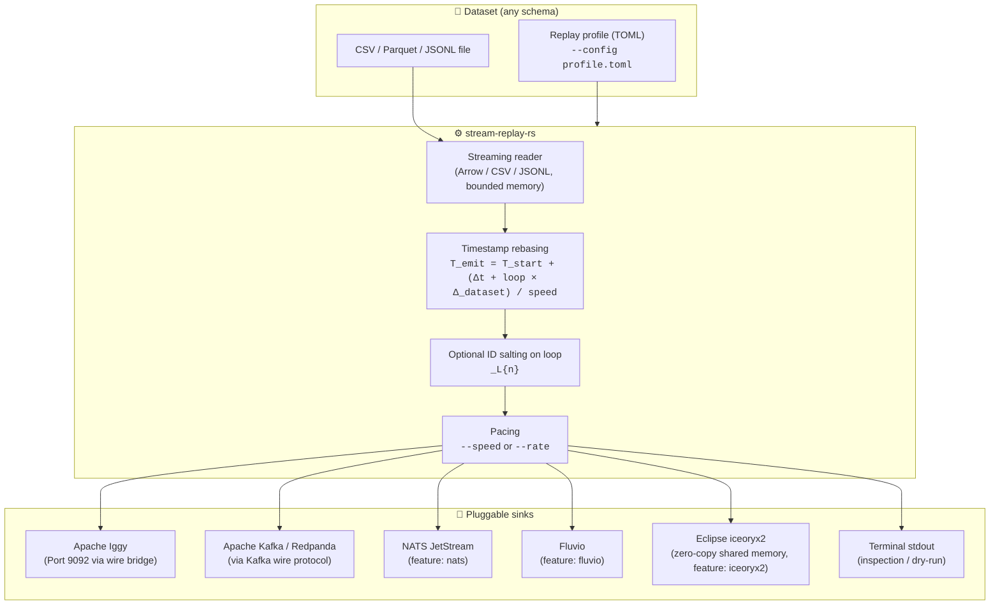

# stream-replay-rs

> **Generic, high-throughput event replayer in pure Rust**  
> Turns any historical CSV, Parquet or JSONL dataset into a live event stream: it rebases the dataset's timestamps onto the live clock, paces events by speed or fixed rate, and publishes them to Apache Iggy (via wire-protocol bridge), Apache Kafka / Redpanda, NATS JetStream, Fluvio, Eclipse iceoryx2 shared memory, or stdout.

[](#-license)
[](#-requirements--installation)
[](#-tier-1-devsecops--security-gate)

---

## 🏛️ What It Does

`stream-replay-rs` is a single-responsibility tool. It owns the **replay mechanics** only: reading a dataset, rebasing timestamps, pacing, looping and publishing to a sink. It knows nothing about the dataset it replays or the system that consumes it. Datasets, replay profiles, and the topics or subjects events are published to belong to whoever runs the replay.

It ships as a standalone CLI (`main.rs`) and as an embeddable library crate (`lib.rs`).



---

## 📦 Requirements & Installation

- **Rust compiler**: Rust 1.85+ (MSRV)
- **Pre-commit**: (optional, for local git hook enforcement) `pip install pre-commit && pre-commit install`
- **Security tools**: `cargo install cargo-deny cargo-audit`

```bash
# From a clone of this repository
cargo install --path .

# Directly from Git
cargo install --git https://github.com/reidlai/stream-replay-rs
```

> [!NOTE]
> **Planned: `cargo install stream-replay-rs`.** The crate is not on crates.io yet (the registry returned 404 on 2026-11-04). Until it is published, install from Git or from a clone as shown above.

---

## ⚡ Key Features

1. **Pure Rust, native binary**: no Python or JVM dependencies. One optimized binary and an embeddable async library.
2. **Streaming reader (<35 MB RSS)**: bounded memory using Apache Arrow record batches, chunked CSV iterators and line-delimited JSONL streaming.
3. **Dataset-agnostic**: CSV, Parquet and JSONL in; a column mapping tells it which column paces the replay and which column is the entity key.
4. **Timestamp rebasing**: historical timestamps in any supported unit or format are rebased onto the live clock (see [Timestamp rebasing and speed](#-timestamp-rebasing-and-speed)). With `--advance-loop-timestamps`, looping never moves time backward.
5. **Speed or fixed rate**: `--speed <n>` rolls the dataset forward `n` times faster than its original spacing; `--rate <n>` emits a fixed number of events per second. The two are mutually exclusive.
6. **Loop entity ID salting**: appends `_L1`, `_L2`, … to entity keys across loops so downstream stores do not see primary-key collisions.
7. **Pluggable sinks**: publishes to Apache Iggy (via wire-protocol bridge on port 9092), Apache Kafka / Redpanda, NATS JetStream, Fluvio, Eclipse iceoryx2 zero-copy shared memory, or terminal `stdout` for inspection and dry-run. `iggy`, `kafka` and `stdout` are in the default build; `nats`, `fluvio` and `iceoryx2` are opt-in [Cargo features](#-cargo-features). A delivery failure ends the run with a non-zero exit code; nothing is simulated. See [Pluggable Sinks](#-pluggable-sinks).
8. **Progress bar**: elapsed time, events sent, live event rate and ETA.

---

## ⏱️ Timestamp Rebasing and Speed

A dataset's timestamps rarely resemble the present: they may be years old, in seconds or milliseconds, or in RFC 3339 text. `stream-replay-rs` therefore never emits a dataset timestamp as it is. At runtime:

1. The first record's pacing-column timestamp becomes the baseline `T0`. The pacing column is the one named by `--timestamp-column` (or auto-detected).
2. The replay is anchored to the system clock: `T_start = now()`.
3. Each record `i` gets its relative offset `Δt_i = t_i − T0`, in nanoseconds.
4. The record is emitted at

   $$T_{\text{emit}} = T_{\text{start}} + \frac{\Delta t_i + \text{loop\_count} \times \Delta_{\text{dataset}}}{s}$$

   where `s` is the speed (`--speed`) and `Δ_dataset` is the dataset span (last pacing timestamp minus first). At `s = 1` the original inter-arrival spacing is preserved; at `s = 10` the dataset rolls forward ten times faster.
5. With `--shift-timestamps` (the default), the pacing column in the payload is rewritten to the emitted time, and every column listed with `--shift-column` is shifted by the same offset, so durations between a record's own timestamps stay consistent.
6. On each loop (`--loop`) pacing continues past the end of the dataset: the schedule offset grows by `Δ_dataset`. With `--advance-loop-timestamps` the payload timestamps advance by the same amount, so the emitted time never goes backward (a strictly increasing 1 ns nudge is applied where a pass starts exactly at the previous pass's last time). `--loop-id-salt` appends `_L{n}` to the entity key.

### Worked example

A dataset has three records, paced by `event_time`:

| Record | `event_time` in file | `Δt` from first |
| :-: | :-- | :-- |
| 1 | 2018-01-01 00:00:00 | 0 s |
| 2 | 2018-01-01 00:00:30 | 30 s |
| 3 | 2018-01-01 00:02:00 | 120 s |

The replay starts at `T_start = 2026-11-04 10:00:00`.

| Speed | Record 1 emitted | Record 2 emitted | Record 3 emitted | Payload `event_time` (default `--event-time compress`) |
| :-- | :-- | :-- | :-- | :-- |
| `--speed 1` | 10:00:00 | 10:00:30 | 10:02:00 | the emitted time |
| `--speed 10` | 10:00:00 | 10:00:03 | 10:00:12 | the emitted time |

With `--loop --advance-loop-timestamps`, the second pass adds `Δ_dataset = 120 s` (divided by the speed) to every offset, so at `--speed 10` record 1 of the second pass is emitted at 10:00:12, record 2 at 10:00:15, and so on.

`--event-time preserve` keeps the original spacing in the payload timestamps even when `--speed` is not 1, while pacing still follows the speed. The default, `compress`, makes event time follow the same compressed schedule as wall-clock time, so stream-processor watermarks advance in real time.

Two cases have no dataset schedule to divide, so under `compress` the payload timestamp is simply the wall-clock time at emission: `--speed max` (no pacing) and `--rate` (fixed events per second). Integer epoch timestamps are written back as integers in the same unit; textual timestamps are written back as RFC 3339.

### Supported timestamp formats

Epoch seconds, milliseconds, microseconds and nanoseconds, and RFC 3339 are auto-detected. Timezone-naive values are treated as UTC. Use `--timestamp-unit` when a unit cannot be detected. Records are assumed to be sorted ascending by the pacing column.

---

## 🚀 Quickstart

### 1. Build

```bash
cargo build --release
```

### 2. Inspect a replay in the terminal (`stdout`)

```bash
./target/release/stream-replay-rs \
  --input-file-path data/events.parquet \
  --timestamp-column event_time \
  --key-column event_id \
  --sink stdout \
  --speed 10 \
  --progress
```

### 3. Publish to Apache Iggy (`iggy`)

```bash
# Apache Iggy streaming broker (via wire-protocol bridge on localhost:9092). The topic must already exist.
./target/release/stream-replay-rs --config config/profiles/example.toml \
  --sink iggy --sink-url localhost:9092 --topic <topic>
```

### 4. Publish to Apache Kafka / Redpanda (`kafka`)

```bash
# Apache Kafka or Redpanda endpoint. The topic must already exist.
./target/release/stream-replay-rs --config config/profiles/example.toml \
  --sink kafka --sink-url localhost:9092 --topic <topic>
```

### 5. Publish to NATS JetStream (`nats`)

```bash
# Build with the nats feature. A JetStream stream capturing the subject must already exist.
cargo build --release --features nats
./target/release/stream-replay-rs --config config/profiles/example.toml \
  --sink nats --sink-url nats://localhost:4222 --topic orders.events
```

### 6. Publish to Fluvio (`fluvio`)

```bash
# Build with the fluvio feature. The topic must already exist.
cargo build --release --features fluvio
./target/release/stream-replay-rs --config config/profiles/example.toml \
  --sink fluvio --sink-url localhost:9003 --topic orders
```

### 7. Publish over Eclipse iceoryx2 shared memory (`iceoryx2`)

```bash
# Build with the iceoryx2 feature. Subscribers on the same host open the same service name.
cargo build --release --features iceoryx2
./target/release/stream-replay-rs --config config/profiles/example.toml \
  --sink iceoryx2 --service-name orders/ipc
```

### 8. Fixed rate

```bash
# Emit 25 events per second regardless of the dataset's own spacing
./target/release/stream-replay-rs --config config/profiles/example.toml --rate 25
```

### 9. Continuous looping with ID salting

```bash
./target/release/stream-replay-rs \
  --input-file-path data/events.parquet \
  --loop --advance-loop-timestamps --loop-id-salt \
  --speed 50
```

---

## 📚 Programmatic Library Usage

Add `stream-replay-rs` to your `Cargo.toml`:

```toml
[dependencies]
stream-replay-rs = { git = "https://github.com/reidlai/stream-replay-rs" }
tokio = { version = "1.40", features = ["full"] }
```

Embed the `ReplayEngine` in a Rust service or test harness. `ReplayConfig::builder().max_records(n)` stops the replay after `n` records, which is useful for looped replays in tests (there is no CLI flag for it):

```rust
use stream_replay_rs::config::ReplayConfig;
use stream_replay_rs::engine::ReplayEngine;
use std::path::PathBuf;

#[tokio::main]
async fn main() -> Result<(), Box<dyn std::error::Error>> {
    let config = ReplayConfig::builder()
        .file_path(PathBuf::from("data/events.parquet"))
        .file_format("parquet")
        .timestamp_column("event_time")
        .key_column("event_id")
        .speed_multiplier(10.0)
        .progress(false)
        .build()?;

    let mut engine = ReplayEngine::new(config).await?;
    let stats = engine.run().await?;
    println!("Emitted {} records in {:.2?}", stats.total_records, stats.elapsed);
    Ok(())
}
```

---

## 🏷️ Cargo Features

Each transport driver lives behind a Cargo feature, so a default install stays small and fast to compile. `stdout` is always built.

| Feature | Sink(s) enabled | Driver crate | In default build |
|---------|-----------------|--------------|------------------|
| `default` | `kafka` (also serves `iggy`) | `rskafka` | yes |
| `kafka` | `kafka`, `iggy` | `rskafka` | yes |
| `nats` | `nats` | `async-nats` | no |
| `fluvio` | `fluvio` | `fluvio` | no |
| `iceoryx2` | `iceoryx2` | `iceoryx2` | no |
| `full` | all of the above | all of the above | no |

```bash
cargo install --path .                                       # kafka / iggy + stdout
cargo install --path . --features nats,fluvio                # pick transports
cargo install --path . --features full                       # every sink
cargo build --no-default-features                            # stdout only, no broker dependencies
```

Requesting a sink whose feature was not compiled in fails with a clear error, for example `NATS sink requested, but stream-replay-rs was compiled without '--features nats'`. The default `kafka` client (`rskafka`) is pure Rust, so a default `cargo install` needs no CMake, C compiler or OpenSSL.

---

## 📡 Pluggable Sinks

`stream-replay-rs` provides six pluggable sinks: `iggy`, `kafka`, `nats`, `fluvio`, `iceoryx2` and `stdout`. `iggy`, `kafka` and `stdout` are in the default build; the others need their [Cargo feature](#-cargo-features) (or `--features full`).

| Sink | Feature | Target Endpoint | Protocol | Usage & Semantics |
|------|---------|-----------------|----------|-------------------|
| `iggy` | `kafka` (default) | Apache Iggy streaming broker (`localhost:9092`) | Kafka wire protocol via Iggy wire bridge | High-throughput streaming broker replay; keyed partitioning, at-least-once delivery |
| `kafka` | `kafka` (default) | Apache Kafka, Redpanda, or wire-compatible brokers | Native Kafka wire protocol | Distributed streaming replay; keyed partitioning, at-least-once delivery |
| `nats` | `nats` | NATS server with JetStream (`nats://localhost:4222`) | NATS + JetStream | Subject publish with `PubAck` verification; replay headers and `Nats-Msg-Id` for server-side dedup |
| `fluvio` | `fluvio` | Fluvio cluster (`localhost:9003`) | Fluvio SC/SPU | Topic produce routed by `RecordKey`, at-least-once, SPU acknowledgment |
| `iceoryx2` | `iceoryx2` | Local shared-memory service (`--service-name`) | Zero-copy IPC (`[u8]` slices) | Microsecond-level same-host delivery; payload only (no keys or headers) |
| `stdout` | always | Terminal / Standard output | None (formatted text/payload) | Local inspection, dry runs, smoke testing, and pipeline chaining without broker dependencies |

### Supported Sinks

#### 1. Apache Iggy (`--sink iggy`)
- **Configuration**: `--sink iggy --sink-url <host:port> --topic <topic>` or `default_type = "iggy"` in profile.
- **Wire Protocol**: Kafka wire protocol (port 9092) via the Apache Iggy wire bridge.
- **Connection Semantics**: Pure-Rust client (`rskafka`), direct TCP connection, `acks=all` (-1). Delivery is at-least-once with deterministic murmur2 partition routing by key, custom replay tracking headers, and rebased event timestamps.
- **Endpoints**: Apache Iggy streaming broker running with wire bridge (default: `localhost:9092`).

#### 2. Apache Kafka / Redpanda (`--sink kafka`)
- **Configuration**: `--sink kafka --sink-url <host:port> --topic <topic>` or `default_type = "kafka"` in profile.
- **Wire Protocol**: Native Apache Kafka wire protocol (ApiVersions, Metadata, Produce v3+).
- **Connection Semantics**: Pure-Rust client (`rskafka`), direct TCP connection, `acks=all` (-1). Delivery is at-least-once with deterministic murmur2 partition routing by key, custom replay tracking headers, and rebased event timestamps.
- **Endpoints**: Apache Kafka clusters, Redpanda brokers, or any wire-compatible event streaming endpoint (default: `localhost:9092`).

#### 3. NATS JetStream (`--sink nats`, feature `nats`)
- **Configuration**: `--sink nats --sink-url nats://<host>:4222 --topic <subject>` or `default_type = "nats"` in profile. An empty or default Kafka URL becomes `nats://localhost:4222`.
- **Connection Semantics**: pure-Rust `async-nats`; publishes through JetStream and waits for each `PubAck`. A JetStream stream capturing the subject must already exist; `503 No Responders` fails the run.
- **Metadata**: NATS headers `replay.run_id`, `replay.seq`, `replay.loop`, `replay.key`, `replay.timestamp`, plus `Nats-Msg-Id` (`<run_id>:<seq>`) so JetStream can drop retry duplicates.
- **Time limits**: 5 s to connect, 30 s per publish + ack; the first failure latches and ends the run.

#### 4. Fluvio (`--sink fluvio`, feature `fluvio`)
- **Configuration**: `--sink fluvio --sink-url <host>:9003 --topic <topic>` or `default_type = "fluvio"` in profile. An empty or default Kafka URL becomes `localhost:9003`; `profile` or `profile:<name>` selects a Fluvio profile.
- **Connection Semantics**: pure-Rust `fluvio` client, at-least-once delivery, `ReadCommitted` isolation; records are routed by `RecordKey` (the entity key) and each record waits for the SPU acknowledgment. The topic must already exist.
- **Metadata**: Fluvio has no header map, so the replay headers (`replay.run_id`, `replay.seq`, `replay.loop`, `replay.key`, `replay.timestamp`) are added as fields of JSON object payloads.
- **Time limits**: 5 s to connect, 30 s per produce; the first failure latches and ends the run.

#### 5. Eclipse iceoryx2 (`--sink iceoryx2`, feature `iceoryx2`)
- **Configuration**: `--sink iceoryx2 --service-name <name>` (or `--topic <name>`), or `default_type = "iceoryx2"` with `service_name` / `destination` in profile.
- **Connection Semantics**: opens a `publish_subscribe::<[u8]>` service and loans shared-memory slices (zero-copy to subscribers on the same host). Payload bytes only: keys, timestamps and replay headers are not transmitted. A slice larger than the initial 4 KiB grows by powers of two.
- **Backpressure**: subscriber buffers hold 256 samples with safe overflow; a slow subscriber loses the oldest samples while the run continues.
- **Failure**: an invalid service name, a type-incompatible existing service, or a failed loan or send ends the run.

#### 6. Terminal stdout (`--sink stdout`)
- **Configuration**: `--sink stdout` (the default) or `default_type = "stdout"` in profile.
- **Wire Protocol**: None (emits structured event lines to stdout).
- **Connection Semantics**: Zero network activity, bounded memory footprint, and zero broker dependencies. Formatted events are written to terminal standard output, ideal for local inspection, dry runs, smoke testing, or piping into command-line utilities.
- **Endpoints**: Standard output stream.

### Delivery Profile (Network Sinks)

The delivery profile for network sinks (`iggy` and `kafka`) is fixed:

| Setting | Value |
|---------|-------|
| Acknowledgement | `acks=all` (-1); a record counts as sent only after the endpoint confirms it |
| Idempotence, transactions, compression | off |
| Topic | must already exist; the replayer never creates topics |
| Key | the `--key-column` value (with the `_L{n}` salt when looping) |
| Partition | chosen by the replayer: murmur2 of the key modulo the partition count, the same mapping as the Java client and librdkafka's `murmur2_random`; records without a key go round-robin |
| Ordering | one produce request in flight per partition, so order is kept per partition |
| Timestamp | the rebased event time of the record |
| Headers | `replay.run_id` (one per process), `replay.seq` (ordinal of the record in the run), `replay.loop` (loop number) |
| Batching | 5 ms linger, up to 256 KiB per request |
| Time limits | 5 s to connect, 30 s per produce request, 10 s of retries; then the run fails |

**Client.** The network sinks target Apache Iggy via its high-performance wire protocol bridge and Apache Kafka / Redpanda endpoints using [`rskafka`](https://crates.io/crates/rskafka) 0.6 (pure Rust). `rdkafka` was the alternative: it supports idempotence and a delivery callback, but it wraps the C library librdkafka, which needs CMake and a C compiler (it does not build on Windows with default features), so `cargo install` would no longer work with a plain Rust toolchain. `rskafka` sends only ApiVersions, Metadata and Produce, which keeps the endpoint's job small. Its limits (no idempotence, no request timeout, retries forever by default, topic auto-creation always requested) are handled in the sink or by the endpoint: keep topic auto-creation off.

**Failure.** If the endpoint is unreachable, the topic is missing, a produce is rejected, or a request times out, the run stops and the process exits with a non-zero code. A timeout is reported as "may or may not have been written".

**Duplicates.** Delivery is at-least-once. If an answer is lost after a record was written, the retry stores it again under a new offset. Offsets cannot reveal this, but `replay.run_id` and `replay.seq` identify every record, so a consumer can count distinct records.

**Tests.** The test suite runs the network sinks against an in-process fake broker that speaks the real wire protocol. To run the same checks against a real endpoint, create an empty topic and run `KAFKA_TEST_ENDPOINT=host:port KAFKA_TEST_TOPIC=name cargo test -- --ignored`.

---

## 🛠️ CLI Options & Flags

Every setting is also available as a key in the profile file. A CLI flag overrides the profile.

| Flag | Short | Default | Description |
|------|-------|---------|-------------|
| `--config <PATH>` | `-c` | none | Path to a profile TOML file |
| `--input-file-path <PATH>` | `-i` | none | Path to the Parquet, CSV or JSONL dataset |
| `--input-file-format <FMT>` | `-f` | auto | `parquet`, `csv` or `jsonl` |
| `--sink <SINK>` | `-s` | `stdout` | Target sink: `iggy`, `kafka`, `nats`, `fluvio`, `iceoryx2` or `stdout` (`nats`, `fluvio` and `iceoryx2` need their Cargo feature) |
| `--sink-url <URL>` | `-u` | per sink | Endpoint: `localhost:9092` (iggy/kafka), `nats://localhost:4222` (nats), `localhost:9003` (fluvio) |
| `--topic <TOPIC>` | `-t` | `events` | Target topic, NATS subject or iceoryx2 service name; it must already exist |
| `--service-name <NAME>` | | none | iceoryx2 service name (overrides `--topic`) |
| `--speed <n>` | | `1.0` | Rolls the dataset forward `n` times faster than its original spacing (gaps shrink to `Δt / n`). Accepts `10`, `10x` or `max` (no pacing). Values below 1 slow it down. |
| `--rate <N>` | `-r` | none | Fixed events per second, ignoring the dataset's own spacing. Mutually exclusive with `--speed`. |
| `--timestamp-column <COL>` | | auto-detect | The pacing column that drives the emit schedule |
| `--timestamp-unit <UNIT>` | | `auto` | `s`, `ms`, `us`, `ns` or `rfc3339`, when the unit cannot be detected |
| `--shift-column <COL>` | | none | Another timestamp column to rebase by the same offset (repeatable) |
| `--shift-timestamps` / `--no-shift-timestamps` | | on | Off passes payload timestamps through unchanged; pacing still applies |
| `--event-time <compress\|preserve>` | | `compress` | At a speed other than 1, whether rewritten payload timestamps follow the compressed schedule or keep the original spacing |
| `--key-column <COL>` | | none | Entity ID or key column |
| `--loop` | | off | Loop playback indefinitely at end of file |
| `--advance-loop-timestamps` | | off | Advance timestamps monotonically on later loops |
| `--loop-id-salt` | | off | Append `_L{n}` to entity IDs on loop iterations |
| `--progress` / `--no-progress` | | on | Show or hide the progress bar |

> [!NOTE]
> `--speed` and `--rate` are mutually exclusive. When a profile and a flag disagree, the flag wins: `--speed` replaces a profile `rate`, and `--rate` replaces a profile `speed`. When `--timestamp-column` is omitted, the pacing column is auto-detected (the first Parquet timestamp-typed column, otherwise a conventional name such as `timestamp`, `event_time` or `ts`).

---

## ⚙️ Profile Configuration

Reusable replay scenarios are defined in TOML. `config/profiles/example.toml` is the one generic example; real profiles live with the project that owns the dataset. Key names for the extra timestamp settings are not final.

```toml
[dataset]
input_path = "./data/<dataset>.parquet"
format = "parquet"                      # parquet | csv | jsonl
timestamp_column = "<pacing_column>"    # drives the emit schedule
timestamp_unit = "auto"                 # auto | s | ms | us | ns | rfc3339
shift_columns = ["<other_timestamp_column>"]
partition_key = "<partition_key>"

[replay]
speed = 1.0                # 1.0 = original spacing; 10.0 = ten times faster
event_time = "compress"    # compress | preserve
loop = true
advance_timestamps = true
loop_id_salt = true

[sink]
default_type = "iggy"       # iggy | kafka | nats | fluvio | iceoryx2 | stdout (nats, fluvio, iceoryx2 need their Cargo feature)
default_url = "localhost:9092"
destination = "<topic>"      # topic, NATS subject, or iceoryx2 service name
# service_name = "<name>"    # iceoryx2 only; wins over destination
```

Run it:

```bash
stream-replay-rs --config profile.toml
```

Use `rate = <n>` under `[replay]` instead of `speed` for a fixed events-per-second replay.

---

## 🔒 Tier 1 DevSecOps & Security Gate

`stream-replay-rs` follows shift-left DevSecOps standards enforced on local developer workstations, with no external CI dependency.

### Quality & security controls
- **Secret detection**: `gitleaks` pre-commit scanning.
- **Code hygiene**: strict `cargo fmt` and `cargo clippy --all-targets -- -D warnings`.
- **License & dependency audits**: `cargo-deny` and `cargo-audit` policy verification.
- **Performance & testing**: unit and integration tests run in under 10 seconds.

### Dual-shell audit scripts

```bash
# Linux / macOS / WSL
./scripts/audit-and-scan.sh
```

```powershell
# Windows PowerShell
pwsh ./scripts/audit-and-scan.ps1
```

---

## 📄 License

Dual-licensed under the **MIT License** and **Apache License 2.0**.
