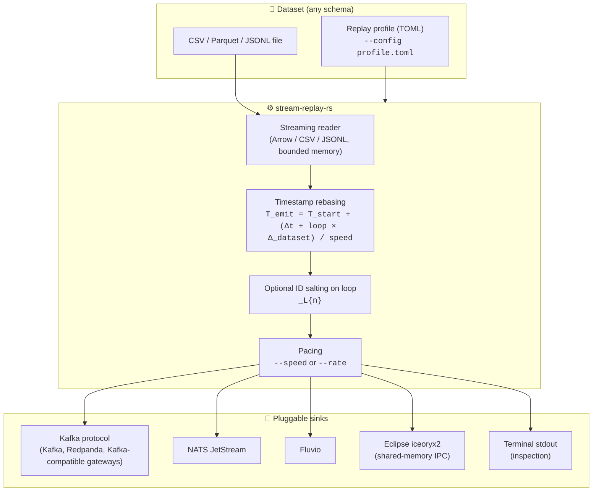

# stream-replay-rs

> **Generic, high-throughput event replayer in pure Rust**  
> Turns any historical CSV, Parquet or JSONL dataset into a live event stream: it rebases the dataset's timestamps onto the live clock, paces events by speed or fixed rate, and publishes them to Kafka-protocol brokers, NATS JetStream or Fluvio.

[](#-license)
[](#-requirements--installation)
[](#-tier-1-devsecops--security-gate)

---

## 🏛️ What It Does

`stream-replay-rs` is a single-responsibility tool. It owns the **replay mechanics** only: reading a dataset, rebasing timestamps, pacing, looping and publishing to a sink. It knows nothing about the dataset it replays or the system that consumes it. Datasets, replay profiles, and the topics or subjects events are published to belong to whoever runs the replay.

It ships as a standalone CLI (`main.rs`) and as an embeddable library crate (`lib.rs`).



---

## 📦 Requirements & Installation

- **Rust compiler**: Rust 1.80+ (MSRV)
- **Pre-commit**: (optional, for local git hook enforcement) `pip install pre-commit && pre-commit install`
- **Security tools**: `cargo install cargo-deny cargo-audit`

```bash
# From a clone of this repository
cargo install --path .

# Directly from Git
cargo install --git https://github.com/reidlai/stream-replay-rs
```

> [!NOTE]
> **Planned: `cargo install stream-replay-rs`.** The crate is not on crates.io yet (the registry returned 404 on 2026-11-04). Until it is published, install from Git or from a clone as shown above.

---

## ⚡ Key Features

1. **Pure Rust, native binary**: no Python or JVM dependencies. One optimized binary and an embeddable async library.
2. **Streaming reader (<35 MB RSS)**: bounded memory using Apache Arrow record batches, chunked CSV iterators and line-delimited JSONL streaming.
3. **Dataset-agnostic**: CSV, Parquet and JSONL in; a column mapping tells it which column paces the replay and which column is the entity key.
4. **Timestamp rebasing**: historical timestamps in any supported unit or format are rebased onto the live clock (see [Timestamp rebasing and speed](#-timestamp-rebasing-and-speed)). With `--advance-loop-timestamps`, looping never moves time backward.
5. **Speed or fixed rate**: `--speed <n>` rolls the dataset forward `n` times faster than its original spacing; `--rate <n>` emits a fixed number of events per second. The two are mutually exclusive.
6. **Loop entity ID salting**: appends `_L1`, `_L2`, … to entity keys across loops so downstream stores do not see primary-key collisions.
7. **Pluggable sinks**: Kafka protocol, NATS JetStream and Fluvio, selected with `--sink`. `stdout` and `iceoryx2` are also available.
8. **Progress bar**: elapsed time, events sent, live event rate and ETA.

---

## ⏱️ Timestamp Rebasing and Speed

A dataset's timestamps rarely resemble the present: they may be years old, in seconds or milliseconds, or in RFC 3339 text. `stream-replay-rs` therefore never emits a dataset timestamp as it is. At runtime:

1. The first record's pacing-column timestamp becomes the baseline `T0`. The pacing column is the one named by `--timestamp-column` (or auto-detected).
2. The replay is anchored to the system clock: `T_start = now()`.
3. Each record `i` gets its relative offset `Δt_i = t_i − T0`, in nanoseconds.
4. The record is emitted at

   $$T_{\text{emit}} = T_{\text{start}} + \frac{\Delta t_i + \text{loop\_count} \times \Delta_{\text{dataset}}}{s}$$

   where `s` is the speed (`--speed`) and `Δ_dataset` is the dataset span (last pacing timestamp minus first). At `s = 1` the original inter-arrival spacing is preserved; at `s = 10` the dataset rolls forward ten times faster.
5. With `--shift-timestamps` (the default), the pacing column in the payload is rewritten to the emitted time, and every column listed with `--shift-column` is shifted by the same offset, so durations between a record's own timestamps stay consistent.
6. On each loop (`--loop`) pacing continues past the end of the dataset: the schedule offset grows by `Δ_dataset`. With `--advance-loop-timestamps` the payload timestamps advance by the same amount, so the emitted time never goes backward (a strictly increasing 1 ns nudge is applied where a pass starts exactly at the previous pass's last time). `--loop-id-salt` appends `_L{n}` to the entity key.

### Worked example

A dataset has three records, paced by `event_time`:

| Record | `event_time` in file | `Δt` from first |
| :-: | :-- | :-- |
| 1 | 2018-01-01 00:00:00 | 0 s |
| 2 | 2018-01-01 00:00:30 | 30 s |
| 3 | 2018-01-01 00:02:00 | 120 s |

The replay starts at `T_start = 2026-11-04 10:00:00`.

| Speed | Record 1 emitted | Record 2 emitted | Record 3 emitted | Payload `event_time` (default `--event-time compress`) |
| :-- | :-- | :-- | :-- | :-- |
| `--speed 1` | 10:00:00 | 10:00:30 | 10:02:00 | the emitted time |
| `--speed 10` | 10:00:00 | 10:00:03 | 10:00:12 | the emitted time |

With `--loop --advance-loop-timestamps`, the second pass adds `Δ_dataset = 120 s` (divided by the speed) to every offset, so at `--speed 10` record 1 of the second pass is emitted at 10:00:12, record 2 at 10:00:15, and so on.

`--event-time preserve` keeps the original spacing in the payload timestamps even when `--speed` is not 1, while pacing still follows the speed. The default, `compress`, makes event time follow the same compressed schedule as wall-clock time, so stream-processor watermarks advance in real time.

Two cases have no dataset schedule to divide, so under `compress` the payload timestamp is simply the wall-clock time at emission: `--speed max` (no pacing) and `--rate` (fixed events per second). Integer epoch timestamps are written back as integers in the same unit; textual timestamps are written back as RFC 3339.

### Supported timestamp formats

Epoch seconds, milliseconds, microseconds and nanoseconds, and RFC 3339 are auto-detected. Timezone-naive values are treated as UTC. Use `--timestamp-unit` when a unit cannot be detected. Records are assumed to be sorted ascending by the pacing column.

---

## 🚀 Quickstart

### 1. Build

```bash
cargo build --release
```

### 2. Inspect a replay in the terminal (no broker)

```bash
./target/release/stream-replay-rs \
  --input-file-path data/events.parquet \
  --timestamp-column event_time \
  --key-column event_id \
  --sink stdout \
  --speed 10 \
  --progress
```

### 3. Publish to a broker

```bash
# Kafka protocol (Kafka, Redpanda or a compatible gateway)
./target/release/stream-replay-rs --config profile.toml \
  --sink kafka --sink-url localhost:9092 --topic <topic>

# NATS JetStream
./target/release/stream-replay-rs --config profile.toml \
  --sink nats --sink-url nats://localhost:4222 --topic <subject>

# Fluvio
./target/release/stream-replay-rs --config profile.toml \
  --sink fluvio --sink-url localhost:9003 --topic <topic>
```

### 4. Fixed rate

```bash
# Emit 25 events per second regardless of the dataset's own spacing
./target/release/stream-replay-rs --config profile.toml --rate 25
```

### 5. Continuous looping with ID salting

```bash
./target/release/stream-replay-rs \
  --input-file-path data/events.parquet \
  --loop --advance-loop-timestamps --loop-id-salt \
  --speed 50
```

---

## 📚 Programmatic Library Usage

Add `stream-replay-rs` to your `Cargo.toml`:

```toml
[dependencies]
stream-replay-rs = { git = "https://github.com/reidlai/stream-replay-rs", features = ["full"] }
tokio = { version = "1.40", features = ["full"] }
```

Embed the `ReplayEngine` in a Rust service or test harness. `ReplayConfig::builder().max_records(n)` stops the replay after `n` records, which is useful for looped replays in tests (there is no CLI flag for it):

```rust
use stream_replay_rs::config::ReplayConfig;
use stream_replay_rs::engine::ReplayEngine;
use std::path::PathBuf;

#[tokio::main]
async fn main() -> Result<(), Box<dyn std::error::Error>> {
    let config = ReplayConfig::builder()
        .file_path(PathBuf::from("data/events.parquet"))
        .file_format("parquet")
        .timestamp_column("event_time")
        .key_column("event_id")
        .speed_multiplier(10.0)
        .progress(false)
        .build()?;

    let mut engine = ReplayEngine::new(config).await?;
    let stats = engine.run().await?;
    println!("Emitted {} records in {:.2?}", stats.total_records, stats.elapsed);
    Ok(())
}
```

---

## 🏷️ Cargo Features

| Feature | Description | Default |
|---------|-------------|---------|
| `kafka` | Kafka protocol sink driver | No |
| `nats` | NATS JetStream publish driver | No |
| `fluvio` | Fluvio streaming driver | No |
| `iceoryx2` | Eclipse iceoryx2 zero-copy shared memory IPC driver | No |
| `full` | Enables all sink drivers | No |

---

## 🛠️ CLI Options & Flags

Every setting is also available as a key in the profile file. A CLI flag overrides the profile.

| Flag | Short | Default | Description |
|------|-------|---------|-------------|
| `--config <PATH>` | `-c` | none | Path to a profile TOML file |
| `--input-file-path <PATH>` | `-i` | none | Path to the Parquet, CSV or JSONL dataset |
| `--input-file-format <FMT>` | `-f` | auto | `parquet`, `csv` or `jsonl` |
| `--sink <SINK>` | `-s` | `stdout` | `kafka`, `nats`, `fluvio`, `iceoryx2` or `stdout` |
| `--sink-url <URL>` | `-u` | `localhost:9092` | Broker connection URL |
| `--topic <TOPIC>` | `-t` | `events` | Target topic, subject or channel |
| `--service-name <NAME>` | | `stream_replay_events` | iceoryx2 service name |
| `--speed <n>` | | `1.0` | Rolls the dataset forward `n` times faster than its original spacing (gaps shrink to `Δt / n`). Accepts `10`, `10x` or `max` (no pacing). Values below 1 slow it down. |
| `--rate <N>` | `-r` | none | Fixed events per second, ignoring the dataset's own spacing. Mutually exclusive with `--speed`. |
| `--timestamp-column <COL>` | | auto-detect | The pacing column that drives the emit schedule |
| `--timestamp-unit <UNIT>` | | `auto` | `s`, `ms`, `us`, `ns` or `rfc3339`, when the unit cannot be detected |
| `--shift-column <COL>` | | none | Another timestamp column to rebase by the same offset (repeatable) |
| `--shift-timestamps` / `--no-shift-timestamps` | | on | Off passes payload timestamps through unchanged; pacing still applies |
| `--event-time <compress\|preserve>` | | `compress` | At a speed other than 1, whether rewritten payload timestamps follow the compressed schedule or keep the original spacing |
| `--key-column <COL>` | | none | Entity ID or key column |
| `--loop` | | off | Loop playback indefinitely at end of file |
| `--advance-loop-timestamps` | | off | Advance timestamps monotonically on later loops |
| `--loop-id-salt` | | off | Append `_L{n}` to entity IDs on loop iterations |
| `--progress` / `--no-progress` | | on | Show or hide the progress bar |

> [!NOTE]
> `--speed` and `--rate` are mutually exclusive. When a profile and a flag disagree, the flag wins: `--speed` replaces a profile `rate`, and `--rate` replaces a profile `speed`. When `--timestamp-column` is omitted, the pacing column is auto-detected (the first Parquet timestamp-typed column, otherwise a conventional name such as `timestamp`, `event_time` or `ts`).

---

## ⚙️ Profile Configuration

Reusable replay scenarios are defined in TOML. `config/profiles/example.toml` is the one generic example; real profiles live with the project that owns the dataset. Key names for the extra timestamp settings are not final.

```toml
[dataset]
input_path = "./data/<dataset>.parquet"
format = "parquet"                      # parquet | csv | jsonl
timestamp_column = "<pacing_column>"    # drives the emit schedule
timestamp_unit = "auto"                 # auto | s | ms | us | ns | rfc3339
shift_columns = ["<other_timestamp_column>"]
partition_key = "<partition_key>"

[replay]
speed = 1.0                # 1.0 = original spacing; 10.0 = ten times faster
event_time = "compress"    # compress | preserve
loop = true
advance_timestamps = true
loop_id_salt = true

[sink]
default_type = "kafka"
default_url = "localhost:9092"
destination = "<topic-or-subject>"
```

Run it:

```bash
stream-replay-rs --config profile.toml
```

Use `rate = <n>` under `[replay]` instead of `speed` for a fixed events-per-second replay.

---

## 🔒 Tier 1 DevSecOps & Security Gate

`stream-replay-rs` follows shift-left DevSecOps standards enforced on local developer workstations, with no external CI dependency.

### Quality & security controls
- **Secret detection**: `gitleaks` pre-commit scanning.
- **Code hygiene**: strict `cargo fmt` and `cargo clippy --all-targets -- -D warnings`.
- **License & dependency audits**: `cargo-deny` and `cargo-audit` policy verification.
- **Performance & testing**: unit and integration tests run in under 10 seconds.

### Dual-shell audit scripts

```bash
# Linux / macOS / WSL
./scripts/audit-and-scan.sh
```

```powershell
# Windows PowerShell
pwsh ./scripts/audit-and-scan.ps1
```

---

## 📄 License

Dual-licensed under the **MIT License** and **Apache License 2.0**.
