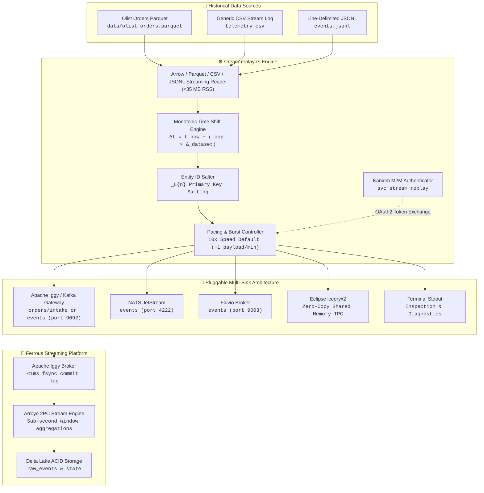

# stream-replay-rs

> **Pure-Rust Streaming Traffic Simulator & Multi-Sink Replay Engine**  
> Standalone, dataset-agnostic event replayer with microsecond monotonic time shifting, 10x playback acceleration, and interactive micro-burst stress testing.

[](#license)
[](#-requirements--installation)
[](#-tier-1-devsecops--security-gate)

---

## 🏛️ Architecture & C4 Topology

`stream-replay-rs` is a high-performance, single-responsibility traffic simulator designed for the **Ferrous Streaming** architecture. It reads static historical datasets (Apache Parquet, CSV, and JSONL), transforms timestamps dynamically to anchor to the live replay clock, and dispatches events into pluggable message brokers and shared-memory IPC sinks.



---

## 📦 Requirements & Installation

- **Rust Compiler**: Rust 1.80+ (MSRV)
- **Pre-commit**: (optional, for local git hook enforcement) `pip install pre-commit && pre-commit install`
- **Security Tools**: `cargo install cargo-deny cargo-audit`

---

## ⚡ Key Features

1. **Pure-Rust & Native Binary**: Zero Python or JVM dependencies. Compiles to an optimized standalone binary and an embeddable async Rust library.
2. **Streaming Reader (<35 MB RSS)**: Bounded memory footprint leveraging Apache Arrow vector record batches, chunked CSV iterators, and line-delimited JSONL streaming (NFR-9).
3. **Monotonic Timestamp Advancement**: Mathematically shifts historical event timestamps forward to the live wall-clock time. Looping iterations continuously advance time without negative deltas or backward jitter:
   $$\text{Timestamp}_{\text{emitted}} = \text{Timestamp}_{\text{record}} + \Delta_{\text{now}} + (\text{loop\_count} \times \Delta_{\text{dataset}})$$
4. **Loop Entity ID Salting**: Appends loop iteration markers (`_L1`, `_L2`) to entity primary keys (e.g. `order_id`) across infinite loops, preventing primary key deduplication collisions in downstream Delta Lake sinks.
5. **Configurable Playback Speed Multipliers & Fixed Rate Pacing**:
   - Linear playback speed acceleration presets (`1x` real-time, `10x` default accelerated, `50x` high-throughput, or `0x` / `max` unthrottled line rate) as well as arbitrary float multipliers (`--speed 25.5`).
   - Fixed event throughput injection via `--rate <N>` (events per second) for deterministic throughput benchmarking.
   - Paces inter-arrival delays with microsecond precision using Tokio asynchronous timers.
6. **Interactive Micro-Burst Testing**:
   - Supports `--burst <N>` to instantly inject batches (e.g. `--burst 500` payloads) without pacing delays in under 1 second (>500 msgs/s), validating backpressure and buffer stability in Apache Iggy and Arroyo (FR-30).
7. **M2M Authentication**: Pre-flight Kanidm OAuth2 token exchange for `svc_stream_replay` (scopes: `stream:produce:intake`, `telemetry:write`) with offline fallback for disconnected development.

---

## 🏁 Streaming Benchmark: Ferrous Streaming (Iggy + Arroyo) vs. Kafka vs. NATS JetStream vs. Fluvio

`stream-replay-rs` is the load driver for comparing **Ferrous Streaming** (Apache Iggy broker + Arroyo stream engine + Delta Lake) with **Apache Kafka**, **NATS JetStream** and **Fluvio**. Apache Iggy and Arroyo are a broker plus a stream engine, while the others are brokers only, so the comparison has two layers.

### Layer 1: Broker Architecture (broker only)

| Dimension | Apache Iggy | Apache Kafka | NATS JetStream | Fluvio |
| :--- | :--- | :--- | :--- | :--- |
| **Language / Runtime** | Rust (no GC) | Java / Scala (JVM, GC) | Go (GC) | Rust (no GC) |
| **I/O Model** | Thread-per-core, shared-nothing, `io_uring` | Multi-threaded, OS page cache, `sendfile` | Go runtime, file or memory storage | Async Rust (SPU) |
| **Deployment Footprint** | Single native binary | JVM + KRaft controllers | Single native binary | Cluster of SC + SPU processes |
| **Tail-Latency Sources** | No GC pauses | JVM GC, producer batching (`linger.ms`) | Go GC | No GC pauses |
| **Inline Processing** | None (use a stream engine) | Kafka Streams / external engines | Consumers only | SmartModules (WASM) |
| **`stream-replay-rs` Sink** | `--sink kafka` (Kafka-compatible gateway) | `--sink kafka` | `--sink nats` | `--sink fluvio` |

### Layer 2: End-to-End Ingest to Lakehouse

| Pipeline | Broker | Processing | Storage |
| :--- | :--- | :--- | :--- |
| **Ferrous Streaming** | Apache Iggy | Arroyo (SQL, 2PC checkpoints) | Delta Lake |
| **Kafka stack** | Apache Kafka | Flink / Spark Structured Streaming / Kafka Connect | Parquet / Delta / Iceberg |
| **NATS stack** | NATS JetStream | Custom consumers | Custom Parquet writer |
| **Fluvio stack** | Fluvio | SmartModules + sink connectors | Custom Delta / Parquet writer |

### Published Benchmark Figures

Figures below are **as published by each project or vendor** (retrieved 2026-10-31). They come from different hardware, payload sizes, replication and durability settings, so they are **not a head-to-head comparison**. Read each row with its conditions, and follow the source before quoting a number.

| System | Published figure | Published by / conditions | Confidence |
| :--- | :--- | :--- | :--- |
| **Apache Iggy** | Peak ~**2.0 GB/s** (~3.36M msgs/s), p99 ~**0.495 ms** at peak | Apache Iggy project benchmarks (`iggy-bench`); AWS `i4i` instances, Intel Xeon, 16 consumers, 1000 B messages, 250 msgs/batch. Source: [benchmarks.iggy.apache.org](https://benchmarks.iggy.apache.org) | Primary, project-published; tuned for peak throughput |
| **Apache Kafka** | Peak **605 MB/s**; p99 end-to-end ~**5 ms** at 200 MB/s | Confluent, Aug 2020, Kafka vs Pulsar vs RabbitMQ on a standard cloud testbed. Source: [Confluent benchmark blog](https://www.confluent.io/blog/kafka-fastest-messaging-system/) | Primary, vendor-published; 2020 results |
| **NATS JetStream** | ~**50K to 400K+** msgs/s with file storage; ~**1 to 5 ms** with persistence | No single authoritative benchmark found; ranges come from secondary write-ups and depend on payload, disk, sync interval and replicas. Reference: [NATS docs](https://docs.nats.io) and `nats bench` | **Low**: secondary sources only |
| **Fluvio** | InfinyOn reports **~20x to 38x lower p99 latency** and **~1.5x higher throughput** than Kafka; **~50 MB** idle RAM vs **~1 GB** for Kafka | InfinyOn (Fluvio's maintainers) comparison with Kafka at default settings (replication factor 1), later discussed critically by the community. Source: [InfinyOn blog](https://www.infinyon.com/blog/) | Vendor claim, reported via secondary sources; defaults and RF=1 |
| **Arroyo** (processing layer) | Arroyo reports large gains over Flink on **sliding windows** (up to ~10x); similar to Flink on simple filters and tumbling windows | Arroyo project engineering blog. Source: [arroyo.dev blog](https://www.arroyo.dev/blog/) | Vendor claim; workload-specific |

> [!WARNING]
> Not directly comparable: Iggy's figure is peak throughput with many consumers, Kafka's is a 2020 mid-size cloud setup, NATS's is a range, and Fluvio's is a relative claim against Kafka. No source above benchmarks Iggy, Kafka, NATS JetStream and Fluvio together on the same hardware. A single independent head-to-head would be needed to rank them, and none of the published figures involve `stream-replay-rs`.

---
## 🚀 Quickstart

### 1. Build Native Binary
```bash
cargo build --release
```

### 2. Standalone Quickstart (Isolated Development)

#### Option A: Terminal Stdout Inspection (Zero-Dependency)
Inspect formatted replay events and monotonic time-shifting immediately in your terminal:
```bash
./target/release/stream-replay-rs \
  --input-file-path data/olist_orders.parquet \
  --sink stdout \
  --speed 10x \
  --progress
```

#### Option B: Minimal Standalone Broker (`docker-compose.dev.yml`)
Start an isolated Apache Iggy message broker locally on port 9092 in seconds:
```bash
# 1. Start lightweight dev broker
docker compose -f docker-compose.dev.yml up -d

# 2. Stream historical events to localhost:9092
./target/release/stream-replay-rs \
  --input-file-path data/olist_orders.parquet \
  --sink kafka \
  --sink-url localhost:9092 \
  --topic orders/intake \
  --speed 10x \
  --progress
```

---

### 3. Integrated Ferrous Streaming Platform Quickstart

In the multi-submodule ecosystem, stream directly into the unified **Apache Iggy + Arroyo Stream Engine + Delta Lake** tier:

```bash
# 1. From workspace root, start the streaming platform tier
docker compose -f ../ferrous-streaming/docker-compose.yml up -d

# 2. Launch the replayer targeting the intake stream
./target/release/stream-replay-rs \
  --input-file-path data/olist_orders.parquet \
  --sink kafka \
  --sink-url localhost:9092 \
  --topic orders/intake \
  --speed 10x \
  --progress

# 3. Monitor live pipeline telemetry & tumbling micro-batches:
#    Arroyo Web Console: http://localhost:5115/pipelines
#    Iggy Management:   http://localhost:3000
```

---

### 4. Interactive Micro-Burst Stress Testing
```bash
# Injects 500 events instantaneously (<1s, >500 msgs/s) to evaluate backpressure
./target/release/stream-replay-rs \
  --input-file-path data/olist_orders.parquet \
  --sink kafka \
  --sink-url localhost:9092 \
  --topic orders/intake \
  --burst 500
```

---

### 5. Continuous Looping Simulation with Entity Salting
```bash
# Loops the dataset continuously with monotonic time advancement and ID salting (_L1, _L2)
./target/release/stream-replay-rs \
  --input-file-path data/olist_orders.parquet \
  --loop \
  --advance-loop-timestamps \
  --loop-id-salt \
  --speed 50x
```

---

## 📚 Programmatic Library Usage

Add `stream-replay-rs` to your `Cargo.toml`:

```toml
[dependencies]
stream-replay-rs = { path = "../stream-replay-rs", features = ["full"] }
tokio = { version = "1.40", features = ["full"] }
```

Embed the `ReplayEngine` into your Rust microservice or test harness:

```rust
use stream_replay_rs::config::ReplayConfig;
use stream_replay_rs::engine::ReplayEngine;
use std::path::PathBuf;

#[tokio::main]
async fn main() -> Result<(), Box<dyn std::error::Error>> {
    let config = ReplayConfig::builder()
        .file_path(PathBuf::from("data/olist_orders.parquet"))
        .file_format("parquet")
        .timestamp_column("order_purchase_timestamp")
        .key_column("order_id")
        .speed_multiplier(10.0) // 10x calibrated speed
        .progress(false)
        .build()?;

    let mut engine = ReplayEngine::new(config).await?;
    let stats = engine.run().await?;
    println!("Emitted {} records in {:.2?}", stats.total_records, stats.elapsed);
    Ok(())
}
```

---

## 🏷️ Cargo Features

| Feature | Description | Default |
|---------|-------------|---------|
| `kafka` | Apache Kafka / Apache Iggy gateway sink driver | No |
| `nats` | NATS JetStream publish driver | No |
| `fluvio` | Fluvio distributed streaming driver | No |
| `iceoryx2` | Eclipse iceoryx2 zero-copy shared memory IPC driver | No |
| `full` | Enables all sink drivers and protocols | No |

---

## 🛠️ CLI Options & Flags

| Flag | Short | Default | Description |
|------|-------|---------|-------------|
| `--config <PATH>` | `-c` | `None` | Path to profile TOML configuration file |
| `--input-file-path <PATH>` | `-i` | `None` | Path to Parquet, CSV, or JSONL dataset file |
| `--input-file-format <FMT>` | `-f` | Auto | File format (`parquet`, `csv`, or `jsonl`) |
| `--sink <SINK>` | `-s` | `stdout` | Target sink: `kafka`, `nats`, `fluvio`, `iceoryx2`, `stdout` |
| `--sink-url <URL>` | `-u` | `localhost:9092`| Broker connection URL |
| `--topic <TOPIC>` | `-t` | `events` | Target topic or channel name |
| `--service-name <NAME>` | | `stream_replay_events` | iceoryx2 service name |
| `--speed <PRESET>` | | `10x` | Speed multiplier (`1x`, `10x`, `50x`, `max`, or float) |
| `--rate <N>` | `-r` | `None` | Fixed event injection rate (events/second) |
| `--shift-timestamps` | | `true` | Anchor first event timestamp to current wall-clock time |
| `--timestamp-column <COL>` | | `timestamp` | Timestamp column name in dataset |
| `--key-column <COL>` | | `None` | Entity ID/key column name (auto-detected for Olist) |
| `--loop` | | `false` | Loop playback indefinitely upon reaching EOF |
| `--advance-loop-timestamps`| | `false` | Advance timestamps monotonically on subsequent loops |
| `--loop-id-salt` | | `false` | Append `_L{n}` salt to entity IDs on loop iterations |
| `--progress` | | `true` | Display interactive progress bar |
| `--burst <N>` | | `None` | Inject micro-burst of N events immediately without pacing |
| `--auth-url <URL>` | | `None` | Kanidm authentication server URL |
| `--svc-account <ID>` | | `svc_stream_replay` | Kanidm M2M service account ID |
| `--svc-secret <SECRET>` | | `None` | Kanidm client secret for token exchange |
| `--svc-token <TOKEN>` | | `None` | Pre-issued Kanidm bearer token |

---

## ⚙️ Profile Configuration (`profile.toml`)

Reusable replay scenarios can be defined in TOML profiles:

```toml
input_file_path = "data/olist_orders.parquet"
sink = "kafka"
sink_url = "localhost:9092"
topic = "orders/intake"
speed = "10x"
shift_timestamps = true
timestamp_column = "order_purchase_timestamp"
key_column = "order_id"
loop_playback = true
advance_loop_timestamps = true
loop_id_salt = true

# Kanidm M2M Credentials
auth_url = "https://localhost:8443"
service_account = "svc_stream_replay"
service_secret = "m2m_stream_replay_secret_token"
```

Execute via profile:
```bash
stream-replay-rs --config profile.toml
```

---

## 🔒 Tier 1 DevSecOps & Security Gate

In accordance with architectural decision **AD-13**, `stream-replay-rs` adheres to shift-left DevSecOps standards enforced entirely on local developer workstations with zero external GitHub Actions dependencies.

### Quality & Security Controls:
- **Secret Detection**: `gitleaks` pre-commit scanning.
- **Code Hygiene**: Strict `cargo fmt` and `cargo clippy --all-targets -- -D warnings`.
- **License & Dependency Audits**: `cargo-deny` and `cargo-audit` policy verification.
- **Performance & Testing**: 100% of unit and integration tests execute in <10 seconds.

### Dual-Shell Audit Scripts:

Both scripts provide complete cross-platform operational parity and return standard exit codes:

```bash
# Linux / macOS / WSL
./scripts/audit-and-scan.sh
```

```powershell
# Windows PowerShell
pwsh ./scripts/audit-and-scan.ps1
```

---

## 📄 License

Dual-licensed under the **MIT License** and **Apache License 2.0**.
