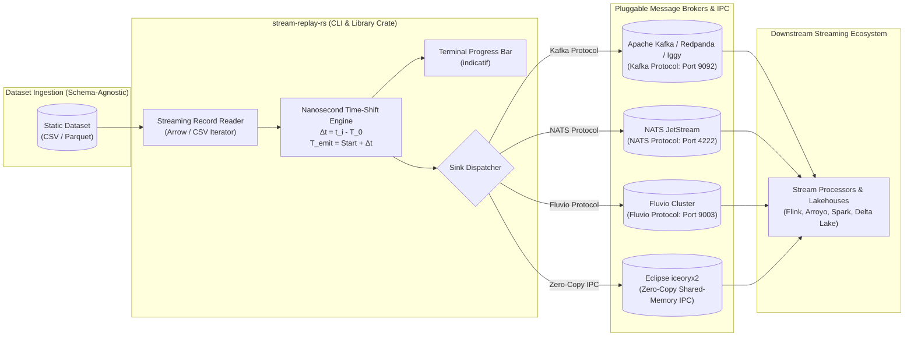

# stream-replay-rs

[](https://github.com/reidlai/stream-replay-rs)
[](LICENSE)
[](.github/workflows/devsecops-ci.yml)
[](.pre-commit-config.yaml)
[](#pluggable-streaming-sinks)

**`stream-replay-rs`** is a generic, high-performance streaming traffic replay engine built in pure Rust. It transforms any historical or static dataset (**CSV** or **Parquet**) into a live, continuous event stream by reading records progressively, calculating relative transaction intervals with **nanosecond precision**, and shifting timestamps forward to anchor to the live replay start time.

Delivered simultaneously as a standalone terminal CLI (`src/main.rs`) and an embeddable library crate (`src/lib.rs`), `stream-replay-rs` is completely **dataset-agnostic** and **broker-pluggable**. It allows engineers to stress-test real-time streaming architectures, event brokers, and lakehouse engines with authentic traffic dynamics while eliminating synthetic data generators and cross-language runtime overhead.

---

## 🏛️ System Architecture

`stream-replay-rs` acts as a generic streaming ingestion harness across distributed event platforms:



### Supported Streaming Transports

| Destination Sink | Default Port | Protocol | CLI Flag | Compatible Brokers & Targets |
| :--- | :--- | :--- | :--- | :--- |
| **Apache Kafka** | `9092` | Kafka Wire Protocol (TCP) | `--sink kafka` | Apache Kafka, Redpanda, Apache Iggy, WarpStream |
| **NATS JetStream**| `4222` | NATS Client Protocol | `--sink nats` | NATS Core, NATS JetStream |
| **Fluvio** | `9003` | Fluvio Native Protocol | `--sink fluvio`| Local Fluvio cluster, InfinyOn Cloud |
| **Eclipse iceoryx2** | *Shared Memory* | Zero-Copy Shared-Memory IPC | `--sink iceoryx2` | Local pure-Rust IPC, ultra-low latency co-located consumers |

---

## ⚡ Key Capabilities

1. **Dataset-Agnostic & Schema-Flexible:**
   * Works out-of-the-box with **any CSV or Parquet dataset** containing a timestamp column (e.g. financial ticks, IoT telemetry, clickstreams, e-commerce orders, server logs).
   * Automatically parses ISO 8601 strings, UNIX epoch seconds, milliseconds, microseconds, and nanoseconds.
2. **Nanosecond Relative Timestamp Shifting:**
   * Reads the baseline timestamp $T_0$ from the first record in the dataset.
   * Anchors playback start time to live wall-clock time: $T_{\text{start}} = \text{Utc::now()}$.
   * Computes the relative delta $\Delta t_i = t_i - T_0$ in nanoseconds for each subsequent record.
   * Emits each record at $T_{\text{emit}} = T_{\text{start}} + \Delta t_i$, preserving authentic transaction bursts, quiet periods, and inter-arrival intervals without triggering watermark drops in downstream stream processors.
3. **Dual Surface (Standalone CLI + Library Crate):**
   * **CLI (`src/main.rs`):** Ready-to-run binary with rich argument parsing and interactive progress output.
   * **Library (`src/lib.rs`):** Async Rust API for embedding controlled streaming traffic generation directly into integration test suites (`cargo test`) or custom benchmarking runners.
4. **Minimal Memory Footprint:**
   * Iterates record-by-record via Apache Arrow streaming reader and line-based CSV iterators, sustaining memory consumption below **35 MB RSS** regardless of dataset file size.
5. **Interactive Console Progress Bar:**
   * Built with `indicatif`, displaying real-time events/sec rate, total records dispatched, elapsed duration, and estimated completion time (ETA).
6. **Playback Acceleration & Infinite Looping:**
   * `--speed <multiplier>` (e.g. `10.0` for 10x accelerated replay).
   * `--rate <events_per_sec>` (fixed throughput injection).
   * `--loop`, `--advance-loop-timestamps`, and `--loop-id-salt` (`_L{n}`) to run infinite continuous replay loops without duplicate primary key collisions.
7. **Profile-Driven Historical Streaming Configuration (`--config <path>`):**
   * Encapsulates all historical data streaming requirements—dataset paths, timestamp columns, partition keys, playback acceleration, loop policies, and destination broker sinks—into version-controlled TOML profiles (e.g. `config/profiles/olist.toml`).
   * Eliminates the need for downstream submodules to maintain traffic ingestion parameters.

---

## 🛠️ Standalone Developer Quickstart

`stream-replay-rs` can be cloned, built, and tested independently with zero external monorepo dependencies.

### Prerequisites

* **Rust:** `1.82+` (`rustup update stable`)
* **Pre-commit (Optional for contributors):** `3.8+` (`pip install pre-commit` or `pipx install pre-commit`)

### 1. Build and Test

```bash
# Clone the repository
git clone https://github.com/reidlai/stream-replay-rs.git
cd stream-replay-rs

# Compile release binary and library
cargo build --release

# Run unit and integration tests
cargo test --all-targets --verbose
```

### 2. Install CLI Binary Globally

```bash
cargo install --path .
```

---

## 💻 CLI Usage & Command Reference

```text
Usage: stream-replay-rs [OPTIONS] [--input-file-path <PATH> | --config <PATH>]

Options:
  -c, --config <PATH>                Path to replay profile configuration file (.toml)
  -i, --input-file-path <PATH>       Path to CSV or Parquet dataset file
  -f, --input-file-format <FORMAT>   File format: 'csv' or 'parquet' [default: auto-detect from extension]
  -s, --sink <SINK>                  Target streaming sink: 'kafka', 'nats', 'fluvio', or 'iceoryx2' [default: kafka]
  -u, --sink-url <URL>               Target broker connection URL [default: localhost:9092]
  -t, --topic <TOPIC>                Destination topic or subject name [default: events]
      --service-name <NAME>          Target iceoryx2 service name (when --sink iceoryx2) [default: stream_replay_events]
      --speed <FLOAT>                Playback speed multiplier (e.g. 1.0 = real-time, 5.0 = 5x) [default: 1.0]
  -r, --rate <INT>                   Fixed target injection rate in events/second (overrides speed)
      --shift-timestamps             Shift relative timestamps anchoring first record to now [default: true]
      --timestamp-column <NAME>      Timestamp column name in dataset [default: timestamp]
      --loop                         Loop replay indefinitely upon reaching EOF
      --advance-loop-timestamps      Monotonically advance timestamps on subsequent loop iterations
      --loop-id-salt                 Append loop counter salt (_L1, _L2) to primary keys to prevent collisions
      --progress                     Display terminal interactive progress bar [default: true]
  -h, --help                         Print help
  -V, --version                      Print version
```

### Example Commands

#### 1. Replay with Centralized Configuration Profile:
```bash
# Execute historical streaming using the bundled Olist profile targeting Kafka/Iggy
stream-replay-rs --config config/profiles/olist.toml

# Override destination sink to NATS JetStream, Fluvio, or Eclipse iceoryx2 on the fly:
stream-replay-rs --config config/profiles/olist.toml --sink nats --sink-url nats://localhost:4222
stream-replay-rs --config config/profiles/olist.toml --sink fluvio --sink-url localhost:9003
stream-replay-rs --config config/profiles/olist.toml --sink iceoryx2 --service-name olist_orders
```

#### 2. Replay Parquet Dataset to Kafka at 5x Speed (Manual CLI):
```bash
stream-replay-rs \
  --input-file-path ./data/events.parquet \
  --input-file-format parquet \
  --sink kafka \
  --sink-url localhost:9092 \
  --topic telemetry \
  --timestamp-column event_time \
  --speed 5.0
```

#### 2. Replay CSV Dataset to NATS JetStream at a Fixed Rate (200 events/sec):
```bash
stream-replay-rs \
  --input-file-path ./data/transactions.csv \
  --input-file-format csv \
  --sink nats \
  --sink-url nats://localhost:4222 \
  --topic orders.incoming \
  --timestamp-column created_at \
  --rate 200
```

#### 3. Continuous Looping Replay to Fluvio:
```bash
stream-replay-rs \
  --input-file-path ./data/sensor_readings.parquet \
  --sink fluvio \
  --sink-url localhost:9003 \
  --topic sensor-stream \
  --loop \
  --advance-loop-timestamps \
  --loop-id-salt
```

#### 4. Ultra-Low Latency Zero-Copy Replay to Eclipse iceoryx2 IPC:
```bash
stream-replay-rs \
  --input-file-path ./data/transactions.parquet \
  --sink iceoryx2 \
  --service-name market_stream \
  --speed 1.0
```

---

## 📦 Using as a Rust Library (`lib.rs`)

Add `stream-replay-rs` to your `Cargo.toml`:

```toml
[dependencies]
stream-replay-rs = { git = "https://github.com/reidlai/stream-replay-rs.git", features = ["kafka"] }
```

### Programmatic Replay Example

```rust
use stream_replay_rs::{ReplayEngine, ReplayConfig, SinkType};
use std::path::PathBuf;

#[tokio::main]
async fn main() -> Result<(), Box<dyn std::error::Error>> {
    let config = ReplayConfig::builder()
        .file_path(PathBuf::from("./data/transactions.parquet"))
        .timestamp_column("transaction_time")
        .sink(SinkType::Kafka {
            broker_url: "localhost:9092".into(),
            topic: "financial-events".into(),
        })
        .speed_multiplier(2.0)
        .shift_timestamps(true)
        .build()?;

    let mut engine = ReplayEngine::new(config).await?;
    engine.run().await?;

    Ok(())
}
```

---

## 🔌 Pluggable Sinks & Feature Flags

`stream-replay-rs` isolates transport drivers behind Cargo feature flags so library consumers only compile the client libraries they actually use:

| Feature Flag | Included Sink Drivers | Dependencies |
| :--- | :--- | :--- |
| `default` | `["kafka"]` | `rdkafka` |
| `nats` | `["nats"]` | `async-nats` |
| `fluvio` | `["fluvio"]` | `fluvio` |
| `iceoryx2` | `["iceoryx2"]` | `iceoryx2` |
| `full` | `["kafka", "nats", "fluvio", "iceoryx2"]` | All sink drivers enabled |

Build specific feature configurations:
```bash
# Build with NATS only (lightweight, zero C-dependency)
cargo build --release --no-default-features --features nats

# Build with all sink transports enabled
cargo build --release --features full
```

---

## 🛡️ DevSecOps & Quality Assurance

`stream-replay-rs` enforces strict automated quality and security gates:

* **Local Pre-Commit Guardrails (`.pre-commit-config.yaml`):**
  - Code formatting: `cargo fmt --check`
  - Strict linting: `cargo clippy --all-targets -- -D warnings`
  - Secret detection: `gitleaks` scanning to prevent credential leakage
  - File hygiene: Trailing whitespace, EOF newline, and large file rejection (>1MB)
* **Tier 1 DevSecOps CI Pipeline (`.github/workflows/devsecops-ci.yml`):**
  - **SCA (Supply Chain Security):** `cargo-audit` and `cargo-deny` scanning for vulnerable crates and license compliance.
  - **SAST (Static Analysis):** `semgrep` with OWASP Top 10 rulesets.
  - **Automated Testing:** `cargo test --all-targets` with `Swatinem/rust-cache` for rapid CI feedback.

Run local pre-commit checks on all files:
```bash
pre-commit run --all-files
```

---

## ⚙️ Configuration & Environment Variables Reference

| Environment Variable | CLI Flag Equivalent | Default Value | Description | Required |
| :--- | :--- | :--- | :--- | :--- |
| `REPLAY_FILE_PATH` | `-i, --input-file-path` | *None* | Path to CSV or Parquet input dataset | **Yes** |
| `REPLAY_FILE_FORMAT` | `-f, --input-file-format` | `auto` | `csv` or `parquet` | No |
| `REPLAY_SINK` | `-s, --sink` | `kafka` | `kafka`, `nats`, `fluvio`, or `iceoryx2` | No |
| `REPLAY_SINK_URL` | `-u, --sink-url` | `localhost:9092` | Target broker connection URL | No |
| `REPLAY_TOPIC` | `-t, --topic` | `events` | Destination topic or subject name | No |
| `REPLAY_SERVICE_NAME` | `--service-name` | `stream_replay_events` | Destination iceoryx2 service name | No |
| `REPLAY_SPEED` | `--speed` | `1.0` | Relative playback speed multiplier | No |
| `REPLAY_RATE` | `-r, --rate` | *None* | Uniform events/sec injection rate | No |
| `REPLAY_LOOP` | `--loop` | `false` | Enable infinite dataset replay loop | No |
| `REPLAY_TIMESTAMP_COL` | `--timestamp-column` | `timestamp` | Column name used for relative delta calculation | No |

---

## 🤝 Integration with FerrousCX Platform

While `stream-replay-rs` is completely dataset-agnostic, it is utilized by the **FerrousCX** enterprise platform as its official streaming traffic simulator. In FerrousCX Release 1, the platform requires the **Brazilian E-Commerce (Olist)** dataset to simulate real-time e-commerce orders, delivery delays, and customer reviews into the Apache Iggy Write-Ahead Log (`ferrous-streaming`):

```bash
# Example: FerrousCX Olist Order Replay into Apache Iggy
stream-replay-rs \
  --input-file-path ../data/olist_orders.parquet \
  --input-file-format parquet \
  --timestamp-column order_purchase_timestamp \
  --sink kafka \
  --sink-url localhost:9092 \
  --topic orders/intake \
  --speed 10.0 \
  --advance-loop-timestamps \
  --loop-id-salt
```

---

## 📄 License

Dual-licensed under either:
* Apache License, Version 2.0 ([LICENSE-APACHE](LICENSE-APACHE))
* MIT License ([LICENSE-MIT](LICENSE-MIT))

at your option.
